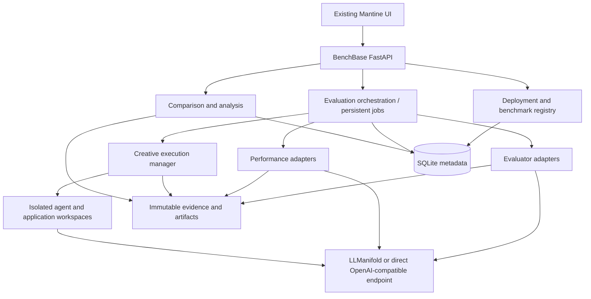

# BenchBase vNext
## Product, architecture and implementation specification

**Revision:** 1.2 · 21 November 2026  
**Audience:** BenchBase owner and coding agents working in Cursor  
**Basis:** existing BenchBase application, CSV export dated 2026-11-21, screenshots, methodology audit and Cursor's response at repository commit `8543f6fd82c9133d3ab4aa954dd28b5665e80a82`  
**Status:** proposed implementation baseline; verify current repository state before editing

**Revision 1.2:** Makes human source-code inspection a required Creative Arena capability. Adds a deliberately minimal read-only viewer, evaluation notes and corresponding acceptance gates. Retains OpenCode as the sole harness and the original benchmark prompt unchanged; no automated comment scoring or additional quality rubric.

---

## 1. Mandate

Evolve BenchBase into a reproducible local-model evaluation laboratory that combines quantitative measurement, interactive observation, and autonomous creative application production. The owner should be able to see not only how a model scores, but how it behaves, how much work it consumes, and what it can make.

This is a significant refactoring and extension of a functioning product, **not a greenfield rewrite**. Preserve the existing React/Mantine experience, FastAPI application, benchmark corpus, historical observations, model records, and working operational features. Replace individual implementations only where evidence demonstrates a need, or where the new architecture requires it.

The three first-class product modes are:

| Mode | Question | Evidence |
|---|---|---|
| Benchmarks | What capabilities does this deployment demonstrate? | Versioned scores, raw item results, measured performance, uncertainty |
| Arena | How does this model respond in actual interaction? | Independently streamed conversations, traces, subjective comparisons |
| Creative Arena | What can this model and agent harness autonomously build? | Runnable applications, inspectable source code, execution history, resource use, human quality ratings |

The three modes are complementary. Do not collapse them into a universal intelligence score. A fast model with mediocre single-shot coding scores may still create excellent applications and be useful as an autonomous worker. A model with high academic scores may be unsuitable for tool use, prolonged deliberation, or creative work.

### 1.1 Product principles

- Preserve historical evidence indefinitely unless the owner explicitly chooses to delete it. Never require a database reset to upgrade.
- Prioritize a useful standard benchmark within approximately one hour on a reasonably fast deployment. Treat the time budget as a planning target, not an accuracy guarantee or a reason to silently shorten a fixed test.
- Keep live question/answer observation central. The visual experience is part of the product, not expendable diagnostic plumbing.
- Own the UX, orchestration, storage, comparison, and integration. Prefer established evaluator implementations where they fit. Do not claim upstream equivalence without validating it.
- Measure deployments and model–harness combinations, not only model names.
- Preserve an owner's ability to explore subjectively. The creative challenge should be fun rather than an exhaustive grading exercise.
- Keep the application useful with remote, heterogeneous, OpenAI-compatible inference endpoints; LLManifold is the owner's gateway. No dependency on LiteLLM or on an external model catalog.
- Make the core sufficiently portable that others could self-host it. Sharing a benchmark or artifact must not require sharing private endpoints, credentials, or the local lab.

### 1.2 Non-goals for this release

No new inference engine, model router, GPU scheduler, general CI/CD platform, public multi-tenant service, automatic aesthetic judge, automated comment-quality/novelty scorer, embedded IDE, or autonomous cluster repair system. Do not convert BenchBase into a replacement for LLManifold. Do not rebuild the old Pi/Oh My Pi agentic feature merely for continuity. No mandatory model or runtime downloads when installing BenchBase. No forced conversion of historic scores to a new scale.

## 2. Verified starting point and unresolved questions

The audit response is evidence about a specific code snapshot, not certification of the running database. Reconcile differences with the current checkout. Preserve the original audit and response as reference material in the repository.

| Finding | Implication |
|---|---|
| Frozen item corpora with per-axis `suite_version` and content hashes; prefix selection by tier | Preserve existing fixtures and item order. Prevent in-place changes to a published corpus identity. |
| Standard sitting comprises eight quality/gate axes, with 602 scored items; 25 format smoke items excluded from work clock | Preserve this exact legacy standard profile. |
| 97 records exported, 37 standard and 5 smoke-only scored deployments in preliminary CSV analysis; 55 without current scores | These are snapshot counts, not permanent system invariants. Explain missing data; do not delete it. |
| Global Borda pool includes smoke results even when Compare hides them | Correct ranking cohort, not just display filter. |
| tinyMMLU anchor fixtures use generated letters, observed pass rates, and IRT deferred; other suites are derivatives | Relabel legacy scores accurately and create separate canonical protocols where appropriate. |
| `ResultItem.raw_answer` often truncated or extracted; complete request and reasoning usually absent | Cannot generally rescore everything. Add full evidence going forward. |
| Arena uses streamed chunk count divided by elapsed time as output TPS | Invalid token label. Correct immediately; distinguish missing or estimated values. |
| Speed uses llama-benchy, thinking-aware gates; some output TPS is null | Preserve reasons and raw benchmark output. Do not invent missing measurements. |
| Existing coding-0 versus no-think pairs and narrow BFCL band | Root causes not established. Analyze production evidence, label unresolved causes. |
| Model identity is a mutable proxy alias | Add immutable deployment/configuration revisions. |
| Existing agentic path uses OMP; owner no longer favors Pi/OMP | Keep historical records, retire unfinished execution UI, implement OpenCode as the required Creative Arena harness. |
| Long-context nominal lengths 8K/16K/32K based on character approximation | Distinguish advertised, requested, measured and demonstrated context. |
| LLManifold uses `/v1/models`; metadata handling still assumes LiteLLM conventions | Make provider-neutral; inspect actual LLManifold schema. |

Primary source locations from the audit: `src/benchbase/{scoring,stats,work_clock,batch_scheduler,run_executor,litellm_client}.py`, `src/benchbase/runners/`, `src/benchbase/api/routes/`, `src/benchbase/db/`, `corpus/suites/`, and `frontend/src/`. The report includes an approximate source index; use real paths and tests from the current checkout rather than treating line numbers as immutable.

## 3. Implementation contract for Cursor

Before implementation, produce a short repository reconciliation and implementation plan. Identify the current migration system, schema, existing recovery/checkpoint behavior, deployment mechanism, test coverage, benchmark/agent code safety boundaries, and any changes since the audited commit. Do not repeat the broad audit unnecessarily.

Implement the work packages in section 14 sequentially or in small reviewable groups. Each package must have tests and a migration/rollback note where applicable. Prefer incremental adapters and facade changes over replacing working modules. Preserve old APIs where reasonably possible; explicitly document breaking public API changes and compatibility shims. Do not rewrite the UI framework or introduce a different database solely to implement this specification. FastAPI + current SQLite persistence + Mantine is the default.

**Do not run expensive model evaluations, invoke the owner's production inference endpoints, launch generated applications, or change live LLManifold configuration as part of development without explicit approval.** Use fixtures, fake endpoints, and tiny synthetic workloads for automated tests. No production secrets in logs, examples, prompts, exports or commits.

Do not execute this entire document as one agent task. Maintain a checklist of acceptance criteria, record implementation decisions, and commit bounded changes. The owner should be able to stop after any package with a usable application.

## 4. Architecture and domain model

Keep modular boundaries within the current application; a microservice deployment is not mandatory. A separate isolated execution worker is required for untrusted generated code. Suggested logical components:



### 4.1 Required identities

Names below represent concepts, not mandatory ORM class names. Adapt them to existing entities; retain existing primary keys and relationships.

| Entity | Required semantics |
|---|---|
| Model/seat | User-facing stable alias, display name, provider, archive/reachability state, user notes |
| Deployment revision | Immutable snapshot of model artifact, quantization, backend, runtime, hardware, context, thinking mode, request defaults, and provenance at evaluation time |
| Benchmark definition revision | Immutable corpus + hashes, prompt template, tier item IDs, protocol, required capabilities, parameters, license/provenance |
| Evaluator revision | Scoring/validation algorithm and version; separate from corpus and generation protocol |
| Profile revision | Versioned collection of benchmark definitions, item selections and performance workload settings |
| Run group / sitting | A requested profile against a deployment revision; retains incomplete/cancelled groups |
| Run / attempt | Concrete execution; identity, timestamps, status, configuration and environment snapshot |
| Observation | Original request, raw response, usage, events, artifacts, errors and measurements. Append-only after completion. |
| Evaluation result | Derived score and outcome referring to an observation and evaluator revision; may coexist with prior evaluations |
| Aggregate / comparison | Recomputable projection with cohort, compatibility and methodology information |
| Creative challenge revision | Immutable brief and execution contract, separate from a creative attempt |
| Creative attempt | Workspace, harness revision, session, telemetry, original outcome, artifact manifests, subjective rating and amendments |

Deployment revisions must distinguish known values, unknown values and operator-supplied assertions. Track artifact/model ID, quantization and revision/hash where available, tokenizer/chat template, advertised vs configured context, effective thinking policy, engine/version, driver, GPU count/type/VRAM and interconnect, RAM, optional power limits/expert-cache parameters and endpoint route. Allow manual overrides with provenance. Never infer precise hardware details from a name alone. Include a normalized, versioned fingerprint; do not include credentials or volatile endpoint health in it. A mutable alias pointing to a different artifact or configuration MUST NOT silently rewrite an old revision.

If a gateway cannot supply enough metadata to detect a changed deployment, flag incomplete identity and allow an explicit new revision. Do not fabricate identity guarantees. Legacy runs should refer to a synthetic historical revision with unknown fields, not a snapshot of today's configuration.

### 4.2 Evidence storage

Use database records for small indexed fields and a managed artifact directory/volume for larger observations, event streams, workspaces and binaries. Compressed JSON/JSONL or equivalent is appropriate. Store content hashes, media types, byte sizes, schema version and relative paths. Atomically finalize evidence manifests; detect broken references and report partial evidence honestly. Do not retain secrets such as Authorization headers or raw environment variables. Limit UI previews without truncating retained evidence. Avoid automatically embedding massive transcripts into a comparison page or AI request.

For each new evaluation item retain:

- Exact sent messages and tool definitions (after rendering), effective generation parameters, corpus/item identity and attempt number.
- Provider response including content, reasoning fields if exposed, tool calls, usage and finish reason, or explicit indication the provider omitted a field. Streaming events if available and useful; transport errors separately.
- Start, first response, first reasoning, first visible content and completion timestamps as available, with monotonic elapsed measurements.
- Extracted answer, expected answer or scoring reference, evaluator revision, decision, structured reason, validation details, and original score.
- Context/token accounting provenance, timeout/truncation, retries, endpoint and configuration revision, relevant cache/telemetry metadata.

Separate generated observations from derived evaluations. Rescoring appends a new evaluator result without overwriting the original observation or score. Preserve the original evaluator result for historical comparison. Historical truncated or extracted answers must remain labeled as such; do not misrepresent them as complete transcripts.

### 4.3 Execution state

Persist job and run state across application restarts. Support queued, provisioning, running, paused, interrupted, completed, failed, cancelled and appropriate invalid states; distinguish missing scores from zero. Record failure cause and attempt history. Resume from a persisted checkpoint only when protocol and corpus are compatible; do not count an item twice. A paused or cancelled run retains its partial observations. Explicit destructive deletion is separate, confirmed and not the default action. Preserve current checkpointing and SSE log delivery; extend rather than replace them.

## 5. Historical preservation and migration

**This is a release-blocking requirement.** Migration must be additive where practical; historical results may be incompatible for ranking without being worthless or inaccessible.

1. Document the actual deployment volume and backup mechanism. Create a consistent SQLite backup using SQLite backup facilities or the existing safe backup process; do not copy a live `.db` while ignoring its WAL. Include existing artifact/log directories and relevant configuration (secrets protected separately).
2. Rehearse upgrades on a disposable copy. Record schema version, row counts, primary keys, score sums/digests and representative historical exports before and after. Exercise rollback/recovery and repeat migration safely.
3. Preserve existing `Model`, `BenchmarkSuite`, `Run`, `Result`, `ResultItem`, `run_group_id`, notes, archives and historical logs. Never update historic scores in place. Backfill only provenance that can be established. Mark unknowns, partial evidence and legacy semantics.
4. Freeze the legacy profile and evaluator IDs, including corpus v2 and long_context v3 where applicable. Import older versions under their actual version identifiers. The current suite pointer must not determine whether historical records can be viewed.
5. Separate version dimensions: corpus, protocol (prompt, sampling, formatting, tool interface, timing rules), evaluator and aggregation/presentation. A score-display change should not require another inference run. A changed prompt or item set is a new protocol, not an evaluator-only correction.
6. Add explicit compatibility classification: **exactly compatible**, **comparable subset** (only where identical items/protocol/evaluator evidence permits), **legacy/non-equivalent**, **insufficient evidence**. An opt-in historical view may display all; no silent common ranking between incompatible results.
7. For a scoring-only fix, run a read-only evidence availability report first. Rescore where enough evidence survives, retain both versions; otherwise mark not retrospectively scorable. Do not fill missing values with zeros.
8. Offer an optional bridge experiment across about 5–10 representative deployment revisions using old/new protocols, recording paired differences and agreement. Do not mechanically calibrate all historic scores from the bridge.

**Acceptance:** representative old model detail pages, archived/unreachable rows, scorecards, raw item data and original scores survive. No model needs to be rerun merely to gain access to prior history. New and old observations coexist. Backup restore verified against a disposable copy. Compare can intentionally select a historical methodology.

## 6. Benchmark definitions and evaluation protocols

### 6.1 Native versus upstream fidelity

Create explicit protocol families:

- **BenchBase Native (legacy v2/v3):** current frozen fixtures and existing scoring behavior, with accurate names and descriptions. These remain useful for longitudinal internal comparison.
- **Upstream / canonical:** independently verified implementations of public benchmark protocols, with pinned source versions, task identifiers, evaluator semantics and documented deviations. A subset, modified prompt, unsupported API fallback, public-only test set or alternate scorer must be labeled as such, not advertised as an official leaderboard-equivalent score.
- **BenchBase Lab:** locally designed tests for agent operations or other capabilities. Reproducible, documented and explicitly custom.

The default should favor a short, reliable qualification experience. Keep the native profile available indefinitely. Introduce canonical pieces independently, with new profile IDs only after they work end-to-end; do not make every backend support every test. Support conditional capability requirements, explicit unsupported outcomes and optional adapter environments.

### 6.2 Legacy profile and future extensions

| Axis | Legacy standard | Preserve / evolution |
|---|---:|---|
| Format/coherency | 25 | Smoke gate; not a quality axis or work-clock denominator |
| Knowledge | 100 | Frozen tinyMMLU anchors, generated choices/raw subset rate. Optional tinyBenchmarks estimator/log-likelihood protocol where applicable; add harder MMLU-Pro subset. |
| Reasoning | 100 | Existing ARC-style fixtures; label as such; retain, supplement harder reasoning. |
| Mathematics | 100 | GSM8K-style numeric extraction; separate format and answer accuracy; optional harder math set. |
| Coding | 40 | Existing curated LiveCodeBench-derived public tests. Preserve; add upstream evaluator option with verified test coverage and sandbox. |
| Tool calling | 125 | BFCL v3-derived five-category subset; investigate shared failures before revision; canonical adapter, native vs prompted mode separated. |
| Instruction | 50 | Existing IFEval-style verifier; add official IFEval scoring and optional IFBench. |
| Structured | 30 | Existing partial JSON-schema validator; real validator with pinned dialect; separate unconstrained and constrained output. Use representative JSONSchemaBench subset if license permits. |
| Long context | 57 | Existing nominal 8/16/32K custom retrieval/track tasks; retain. Add token-verified length sweep and RULER-derived/canonical extension. |
| Speed | Separate | Keep llama-benchy; add AIPerf adapter and common metrics. |

The six legacy quality axes remain knowledge, reasoning, math, coding, tool calling and instruction. Structured output and long context retain their gate role (alongside richer detail); speed remains separate. Do not accidentally introduce a new default score formula under the old identity.

### 6.3 Benchmark adapter contract

Each adapter exposes capabilities, pinned provenance, deterministic item selection, progress, cancellation, execution, scoring, artifact paths and normalized results. It declares whether it needs logprobs, tools, native schema enforcement, specific tokenizer, local code execution or sandboxing. Explicitly distinguish protocol unavailable, model answer wrong, invalid format, refusal where meaningful, generation truncated, transport failure, evaluator exception and timeout. Some categories overlap; use separate outcome dimensions rather than forcing ambiguous cases into one enum. A semantic failure need not invalidate a run; an infrastructure failure must not be silently treated as evidence of poor intelligence. Report planned, attempted, completed, scorable, passed, failed, unparseable, infrastructure error and skipped counts. Define denominators per protocol. Preserve original planned-n semantics for legacy runs and expose any new denominator separately. Retrying an infrastructure failure is permitted only under a declared policy; never select the best of silent retries after incorrect answers.

Use native external framework interfaces (CLI, Python library, JSON output, or callbacks) behind adapters. Do not require a single framework to implement everything. Candidates to evaluate: EleutherAI LM Evaluation Harness or LightEval for suitable canonical tasks, upstream BFCL/IFEval/LiveCodeBench evaluators, Inspect AI for future tool/agent workloads, AIPerf for endpoint performance. Pin versions, check supported APIs and licenses, add lightweight optional dependency groups/worker images, and verify emitted events before promising live output. Do not install or embed these merely because listed; qualify each against the required subset, backend compatibility, reproducibility and overhead.

### 6.4 Time-aware profiles

Keep Smoke, Standard, Thorough and Finalist history. Smoke is a short functional screen, never eligible for default standard rankings. Standard Native retains frozen item IDs and counts. Define future short canonical profiles using fixed item IDs chosen in advance. Estimate duration from recent deployment history or a short probe; show uncertain ETA and actual elapsed/remaining time. User can choose quick screen (~10 min), screening (~30 min), standard (~60 min), or extended, with estimates rather than promises. Never end a standard evaluation at the time budget and present partial scores as a completed standard run. Offer cancel/retain or checkpoint/resume; allow a fixed smaller profile selected before execution. Slow models may exceed the target. Run only relevant capabilities when qualifying a role; allow missing axes explicitly.

## 7. Diagnostics and scientific controls

### 7.1 BFCL investigation (before changing scoring)

Use a **read-only snapshot** of real data, not live production experimentation. Produce item-by-deployment pass/fail/missing matrix, model category breakdowns, common failures, stored examples, and native tools versus prompted JSON evidence where recoverable. Determine whether common hard items, invalid schemas, strict matching, parser incompatibility, API fallback or genuine model behavior explain the compressed scores. Distinguish wrong tool, wrong value/type, malformed call, unnecessary call, missing/parallel call, API rejection, and evaluator failure. Account for protocol mode and endpoint support. Verify correctness with known-good synthetic responses, intentionally wrong calls and nuanced cases such as semantically valid reordered JSON. Compare with pinned canonical scorer where feasible. Do not assume that uniformly failing items are defective or delete hard questions to improve score spread. If a bug is found, create a new evaluator revision, rescore eligible evidence and compare. Record unknowns when evidence insufficient.

### 7.2 Coding and thinking-mode anomaly

The unfinished OMP/Pi agentic benchmark is not the standard single-shot coding axis. Keep these separate. Analyze the named Qwen 3.6 35B and other think/nothink pairs in the stored data: evidence of final code, extracted code, finish reasons, token exhaustion, timeouts, failed test cases, evaluator rejection. Current answer snippets may be inadequate; report that and recommend bounded reproduction only with owner approval. Do not claim causal effects from similarly named historical variants without confirming matched settings.

For future matched experiments, keep artifact, quantization, engine, hardware, prompt and limits constant except for thinking policy. Record visible vs reasoning tokens, total tokens and wall time; distinguish budget exhaustion, repetitive reconsideration, failure to produce a final solution and genuine incorrect code. Optional deliberation-efficiency report: tokens per correct answer, time per correct answer, no-final-answer rate, and repeated-generation observations (heuristic, clearly labeled). Reasoning traces are emitted text, not privileged access to internal reasoning. Avoid pretending that internal tokens can be reconstructed when the API doesn't expose them.

**Security prerequisite:** verify existing LiveCodeBench execution isolation before allowing any generated code to run. A subprocess timeout alone is not sandboxing. Until safe isolation is available, disable execution of generated code by default with an actionable explanation. All coding tests execute in least-privileged disposable sandboxes, with independent expected outputs and resource limits, not in the API process or a shell on the host.

### 7.3 Structured output and context

Validate JSON syntax, schema compliance and semantic correctness separately as supported. Record schema dialect and whether response_format/grammar-constrained decoding was enabled. Do not silently switch between native tool calls and prompted representations within an allegedly uniform protocol. For context tests retain actual prompt token length from exact tokenizer or reliable server usage where possible; otherwise label estimated. Record requested length, actual token count, needle position, output reservation, truncation, configured/advertised maximum and per-length item counts. Preserve legacy gate semantics (100% of its own suite), label gate with its tested limits, and do not equate this with proof of advertised context capacity. Show capability curves for measured lengths (8, 16, 32, 64, 128, 256K where feasible), including not tested. Keep RULER or richer retrieval/aggregation as optional longer tests. No silently reducing length to obtain a pass.

## 8. Inference performance and token accounting

### 8.1 Correct Arena immediately

The existing Arena stream-chunk count is **not token count**. Existing historical values are legacy chunks/sec, not TPS. The Arena must show real token metrics only when supported:

- Prefer validated provider usage with documented counting conventions and, where supported, streaming usage. Distinguish total generated tokens, visible output tokens, reasoning tokens, cached input and other native fields; do not double-count reasoning included in completions. If usage includes all generated tokens, it cannot by itself establish visible-output TPS.
- If unavailable, tokenize the complete accumulated output using the matching model tokenizer and label as tokenizer-derived; decoded text may not exactly reconstruct original tokens. If using a generic tokenizer, label as estimated. Never calculate token count by counting chunks, words or characters and present it as measured. Preserve chunk rate as an optional diagnostic only.
- Use monotonic clocks; distinguish first response event, first generated content (reasoning or visible), first visible content, last relevant content and request end. Do not include keepalives or metadata as first token. When per-token arrival is not exposed, report content/chunk arrival and approximate output-phase rates with provenance, not literal ITL. Do not divide total tokens by a visible-only interval unless numerator matches the interval.
- Display unavailable metrics as an em dash and reason. Don't show 0 for missing usage or failed measurement. Keep old speed results labeled with their provenance.

### 8.2 Common measurements

| Metric | Required semantics |
|---|---|
| TTFT | Client-observed time from request submission to first generated token/content, with reported event granularity; distinguish time to first visible answer |
| TPOT / decode rate | Define token population and time interval (e.g. output tokens after first token over corresponding interval); record first/last timestamps, token count, short-output validity. Do not invent exact timing from batched chunks. |
| ITL | Actual token inter-arrival only where available; otherwise label inter-chunk intervals |
| Prefill TPS | Engine-reported phase duration/token count or documented workload estimate; input length / TTFT is not pure prefill |
| E2E latency | Request start to end, including queue and transfer as observed |
| System throughput | Total completed output tokens / observation window at stated concurrency |
| Goodput | Rate of successful requests meeting explicitly defined latency/throughput SLOs; distinguish correctness if measured |
| Effective work clock | Preserve existing sum of 8 axis active_ms (or documented wall fallback) / correct count; record which intervals/axes, numerator/denominator and validity; null when no corrects |
| Reliability | Errors, timeouts, cancellations, short EOS and retries; separate correctness from serving availability |
| Resources | Optional VRAM, RAM, GPU utilization, cache statistics, power, environment; source and sampling interval; no fabricated estimates |

Use a common typed metrics schema with units, scope, method, source, validity and reason for null, not unstructured fields with conflicting meanings. Keep distributions, request-level raw values, p50/p95/p99 when sample counts support interpretation; label small-sample percentiles. Keep speed index as optional relative comparison with a versioned explicit baseline and compatible profile. No artificial index when no reference.

### 8.3 Performance adapters and workload profiles

Retain existing llama-benchy results, including raw JSON and gate reasons. Introduce AIPerf as an optional headless endpoint load-testing adapter, using a pinned compatible version and documented supported workload definitions; do not require NVIDIA hardware for client-side testing when not needed. Benchmark both direct endpoints and gateway path with an explicit route designation. Do not mix their latency results without labeling. Initial profiles: 128→128, 1K→512, 1K→2048, 4K→512, 16K→1024, 32K→2048, optional 64K/128K context. Select concurrency 1/2/4/8 or other documented levels. Store target vs actual lengths, request arrival mode and random seed, warm-up policy, repetitions, parallel queueing, forced-length vs natural EOS. Do not silently use fixed EOS suppression for a natural-generation test.

Distinguish cold initialization, warm model, prefix/KV cache and expert cache warm-up. For Strata and related engines include domain-switching traces and representative agent workloads in addition to synthetic lengths. Record available cache hit rates/evictions and telemetry; unknown cache state stays unknown. Synchronous external load and thermal state should be recorded when known. Optional load tests must require conscious initiation; don't inadvertently saturate production nodes.

**Acceptance:** fake SSE server delivering multiple tokens per chunk, split text, reasoning and usage events cannot produce mislabeled TPS. Missing usage, no visible response, early EOS, timeout and rejected replicas surface clear reasons. Persist raw inputs to performance calculations. Recompute comparable metrics without re-running when evidence permits.

## 9. Compare, ranking and visual analysis

Preserve the six-axis radar, existing model hover-to-isolate behavior and axis-hover score stacks. Keep sorting, active-only, model-family and archive/unreachable selection filters. Do not sacrifice interactive density for decorative design.

### 9.1 Comparison cohorts

The ranking pool must be defined before scoring and used consistently for UI and exports. Default cohort: compatible **completed standard** runs for the selected profile/protocol; do not mix smoke-only or incompatible thorough results. Thorough can provide a standard-compatible projection only if it contains the same fixed items and protocol with identifiable observations and this projection is explicitly computed. Otherwise use its own cohort. Keep selection/filtering of displayed rows independent of cohort membership by default; allow explicit “rank selected models only” as a clearly labeled alternative. Record denominator, tie rule, profile, filters and version in CSV. Rank all eligible candidates, including any with zero Borda points, unless exclusion is explained; zero points is not missing. Handle incomplete axes deliberately (default six-axis composite requires all compatible quality axes; partial comparisons use common axes and explicit cohort). Keep rank and overall points as optional analytical measures, not dominant badges. Fix ordinal suffixes if retained; show top position/percentile sparingly, exact ranks on hover/detail, and explicit ties. Historical views may show legacy global ranks labeled as such.

Keep Borda formula (N − rank, with documented handling of ties) as a versioned derived ranking, plus any newly introduced alternatives. Do not rewrite historical score data. Gates and speed do not participate in six-axis Borda unless a new explicit ranking mode is defined. Provide useful sort by raw measurement, role, time per correct answer, or selected capability. Add simple Pareto filtering on user-selected compatible metrics with directions and missing-data handling; avoid universal weighted scores. No precision claims based on rank alone.

### 9.2 Heatmap (new primary dense comparison view)

Add a Heatmap tab alongside Radar and Table. Use Mantine components and accessible, color-blind-conscious palettes with text labels and adequate contrast; do not rely solely on red/green. Virtualize or paginate rows when necessary. Preserve model family color as a small identifier, not the cell scale. Sticky headers/first column, compact row heights, search, column sorting, selected model subset, rank cohort indicator and tooltips with original score, sample count, interval, protocol and missing reason.

Modes:

- **Absolute** (default): consistent scale per metric, 0–100 for quality axes. Gates pass/fail/untested with separate context details; don't force speed into 0–100.
- **Relative:** normalize within the explicitly stated cohort by axis, keeping actual numeric values visible. Handle constant columns without false contrast and warn that small or uncertain differences can look large.
- **Delta to baseline:** signed percentage-point differences for compatible accuracy axes, separate units for performance; user chooses reference. Incompatible, absent or invalid data stays marked, not zero.

Keep radar as shape comparison for a small set, with click pinning two or three profiles and persistent baseline option, sorted axis tooltip with scores and CI, readable legend and current hover interactions. Table remains precise inspection/export mode. Optional small multiples only if useful; avoid unnecessary visual clutter.

### 9.3 Uncertainty and comparisons

Preserve Wilson intervals for legacy subset outcomes and label assumptions: they are descriptive binomial intervals under an independence model, not necessarily population confidence intervals for a deliberately chosen item set. Report actual sample size and protocol-specific uncertainty where defensible. For matched items, expose paired outcomes (both pass, both fail, only A, only B), exact McNemar test where assumptions fit, and paired effect sizes; avoid calling overlapping intervals equivalence, and account for non-independent items/stratification where relevant. No false precision, no wholesale significance claims across dozens of exploratory comparisons; distinguish exploratory results. BFCL diagnostic item matrix as a separate view, not main capability heatmap.

## 10. Live inspector and conversational Arena

Preserve the current scrolling console and side-by-side independently streamed model responses (including images for supported vision endpoints). The standard run inspector should show current suite, item index, elapsed, meaningful ETA, status, running counts, current provisional score, effective settings, raw response/reasoning if exposed, extracted answer, expected answer, evaluator reason, token/timing evidence and error details. Let users inspect earlier items without interrupting the run. Provide filter (incorrect, format, unparseable, truncated, infrastructure/evaluator error), search, pause auto-scroll, bookmarks/notes, and raw/extracted toggle. Make heavyweight traces lazy loaded. Use existing SSE if viable, support reconnect/replay from event offsets or persisted logs. If a third-party evaluator cannot emit true live responses, indicate its progress honestly; the adapter must not simulate a live stream.

Arena additions after metrics fix: optional saved sessions/prompts, replay against a new deployment, blind/randomized model labels, user notes and subjective preferences. Store only when explicitly enabled or workspace policy permits; do not persist secrets. The original arena remains usable without saving. Compare the same prompt or conversation history, with independently recorded effective parameters. Do not automatically roll subjective preferences into benchmark Borda.

## 11. Creative Arena — new first-class subsystem

### 11.1 Product intent

Replace the unfinished agentic coding execution experience with a creative application benchmark and gallery. Preserve any existing agentic records and artifacts for inspection; keep the old implementation archived or disabled until removal can be shown safe. Creative Arena is not a LiveCodeBench replacement. It is an intentionally subjective assessment of the **deployment + harness + challenge + execution environment**. The user submits one fixed brief, watches the agent work, opens the generated application, reads its source code and agent transcript as desired, and records a simple quality judgment. Repeat attempts demonstrate consistency rather than only a best-case result.

Required and sole supported Creative Arena harness for vNext: **OpenCode**, via a pinned, version-tested headless integration (SDK/server API or CLI machine-readable events, whichever proves reliable). The owner selected OpenCode specifically for its experience of token-efficient operation and context compaction on small-context local models, and for a shareable distribution that does not require a particular desktop IDE. ZooCode is a useful personal tool, not a BenchBase dependency or integration target. Inspect current official OpenCode interfaces and verify event/usage/compaction availability; do not assume a particular API or that all events are exposed. Retain a narrow internal harness boundary for testing and future maintenance, but do not build a multi-harness framework or harness picker, and do not implement Pi/OMP or ZooCode adapters in this release. OpenCode version, tool definitions, system instructions, compaction policy, provider settings, context limits and model capabilities form part of the immutable attempt protocol. Preserve OpenCode’s normal context-management mechanisms; do not artificially disable compaction merely to simplify instrumentation. Test small-context deployments explicitly and record any automatic compaction or session limit events. OpenCode must use the selected local inference endpoint via LLManifold or an explicit compatible provider; no hidden use of cloud models for compaction, title generation, subagents or other assistance. If auxiliary model calls are allowed by a later protocol, name and log each, count their usage separately, and compare only like protocols. Default single-model attempt should disable or route auxiliary calls to the tested deployment as appropriate; fail clearly if impossible to guarantee under the chosen harness. Do not give benchmark agents access to LLManifold's management MCP or other system-admin credentials.

### 11.2 Canonical first creative challenge

**ID:** `volcano-skunk-v1`  
**Title:** Volcano & Skunk  
**Category:** Creative agentic development  
**Prompt policy:** Preserve exact text below, including “bonus element”. Do not add hidden content requirements or suggested improvements derived from historical successes. Delivery instructions and permitted tools can be supplied by a separate pinned harness/environment contract. Any materially different initial prompt or environment protocol receives a new revision.

```text
Create an advanced, single-page interactive Volcano Simulation dashboard using React, Tailwind CSS, and an optimized HTML5 Canvas for real-time particle simulation. Ensure the canvas resizes dynamically, clears cleanly on frame updates, and uses lightweight particle objects to maintain 60 FPS.

The Canvas Particle Simulation must include:
1. Dynamic Particle Loop: An animation loop using requestAnimationFrame that renders magma, lava chunks, and ash particles blasting upward from a central volcanic vent.
2. Particle Count Control: A functional UI Slider labeled "Emitted Particle Density" (ranging from 50 to 2,000 particles). Adjusting this slider must instantly scale the active particle array size in the canvas engine without crashing the browser.
3. Physics Modifiers: Sliders for Magma Viscosity (alters particle downward gravity and clumpiness) and Gas Pressure (alters the initial Y-axis launch velocity and X-axis spray variance of the particles).
4. Viscosity Preset Profiles: Buttons for Hawaiian (dense, low-velocity red particles flowing down the slopes) and Plinian (massive, high-velocity gray/black ash particles shooting straight up to simulate a massive ash column).
5. Make sure to account for the shape of the volcano and how particles hit it. Once they fall to Earth, they should rapidly cool, disappear, and be recycled. 
Focus on the visual quality of the landscape and the volcano. Make it  varied and three-dimensional appearing rather than symmetrical. The sky should be rich and varied, with smoke and illumination from below. 
As a bonus element, there should be a skunk walking around in the foreground, occasionally also spraying gas. Be creative.
```

Store exact prompt bytes as a fixture and hash them. The duplicated space in “it  varied” and wording are intentional legacy stimulus. If whitespace normalization is necessary for storage, document it rather than silently altering the challenge.

The owner has a strong reference artifact from Trellis (RTX 3090 system, Qwen 3.8 Flash Next UD IQ4 XS, no-think deployment in historical results). It includes a randomized landscape on load, progressively growing/cooling/fading lava rivers, shelter-seeking skunk, and additional Strombolian preset. Screenshot shows 30 FPS at 700 selected particles; this is not a controlled frame-rate measurement. Import its code/build/screenshots as a reference only if available. Historic harness, duration, intervention count and tokens are unknown unless separately established. Do not claim it was a successful one-shot without evidence. Do not prescribe these features to future models: constructive initiative is part of what the owner wants to observe. Do not feed prior artifacts into fresh attempts. The owner also values the reference implementation’s spontaneously written comments explaining visual scale and time scaling, foreground particle compositing to suggest a three-dimensional cone, bounded lava-river lifecycles and an offscreen static scene plate. These are examples of useful evidence of design rationale, not additional benchmark requirements or verified proof of correctness. Do not include this commentary or examples in the agent stimulus, request unusually insightful comments, or reward future attempts for copying the reference.

### 11.3 Attempt lifecycle and one-shot definition

1. Choose challenge revision, deployment revision, environment profile, budgets and repetition count. Resolve and display the pinned OpenCode version/configuration. Show estimated requirements. Default independent repetitions are sequential to avoid contention; simultaneous launches are explicitly a different execution condition.
2. Provision a *fresh isolated* workspace from the pinned base image/template. No generated project sources, previous agent memory, inherited conversation, hidden solution or previous build artifacts. A cached, identical development toolchain/package cache is allowed if recorded.
3. Start agent with exact challenge prompt as one user instruction. Agent may iteratively edit, run tools, test, self-correct, restart services and compact context without losing one-shot eligibility. It may not receive additional human task instructions or edits. Set configurable elapsed, token/call and resource limits; persist limit values and whether enforcement is complete. Suggested first default is a 30-minute attempt, configurable rather than fixed in prompt. Stop on limit, operator cancellation, or agent terminal event. Keep partial artifacts and logs regardless.
4. Record agent-reported completion and independently verify a launchable browser artifact using a controlled process. Distinguish agent-started app, successful independent relaunch/build, HTTP readiness and actual rendered page. Validation must not silently edit generated code or repair missing dependencies beyond the declared launch/build policy. Keep distinct outcomes: completed/runnable without intervention, completed but not runnable, failed, timed out, cancelled, or unknown. Record whether original requirements were fulfilled as owner judgment; do not treat loading a blank page as a working simulation. The primary one-shot indicator means one prompt, no human help, runnable candidate; owner quality judgment remains separate. A launch performed by infrastructure after generation is allowed by protocol, and is labeled separately from an agent successfully launching it itself.
5. Freeze original result: source snapshot, launch manifest, build output if available, trace, telemetry, screenshot, validation and completion state. Subsequent edits must never revise the initial outcome. Allow annotations or ratings independently.
6. Present interactive preview, read-only inspection of the retained source, agent transcript and simple subjective rating. Retain the attempt and allow repetition from a clean workspace, resuming a preview, forking an attempt or optionally continuing a harness session.

### 11.4 Minimal scorecard (not an academic rubric)

Mandatory user-facing measures:

| Measure | Definition |
|---|---|
| One-shot outcome | One initial instruction and no additional human help; independently runnable candidate. Preserve agent launch status separately. |
| Token consumption | Cumulative input, output and total tokens across calls, including compaction/auxiliary calls where observed; avoid reasoning double counting, track estimated/unknown/partial coverage. |
| Context use | Maximum observed per-call context occupation relative to configured effective window (include prompt plus generated history as measurable); show peak numerator/denominator and method. Cumulative tokens are not peak context. |
| Compactions | Observed actual harness context-compaction events, not inferred from decreasing token counts. Explicit unknown if not exposed. |
| Time | End-to-end attempt wall time, plus agent phase and build/startup/dependency setup durations where measurable. Show whether benchmark clock includes preparation. |
| Subjective quality | One optional 1–5 rating (poor, disappointing, adequate, impressive, exceptional), plus freeform comment. Unrated is null; not a failure. |

Additionally store model calls, tool calls, reasoning tokens when exposed, human interventions, errors, finish/stop reason, environment and model/harness versions, per-phase duration, resource/usage evidence and screenshot metadata. If context occupation, token usage or compactions aren't obtainable from the harness, report unknown rather than zero. Collect events from harness and/or authorized inference observation. Do not count identical telemetry twice when both are available. For a complete cumulative total, record coverage of all inference calls; for partial coverage show lower bound or partial, not complete. Make unknown metrics visible in the comparison rather than sorting as zero.

Optional independent artifact checks: browser loads, JS console errors, FPS/frame-time distribution at 50, 500, 2000 particles if accessible, slider/preset interaction, viewport and display conditions. These are diagnostics, not the subjective score. Fixed browser version, viewport/device pixel ratio, rendering hardware and sample procedure for FPS comparability; capture actual particle counts where observable, label unknown otherwise. Don't require screenshots to match reference artwork. Don't impose a complicated automated feature quality rubric or LLM aesthetic judge. Allow owner to note creativity, surprise, visual quality, code quality, design rationale, maintainability or missing requirements in one freeform field. Comments and documentation are evidence for human inspection, not independent scored dimensions. Do not use comment length, count, lexical novelty, corpus similarity, LLM judgments or automated comment-quality scores as proxies for insight. The evaluator may assess whether the code actually substantiates its comments. Do not add a comment-writing instruction to the benchmark prompt.

### 11.5 Workspace and artifact model

Directory layout (illustrative; use immutable IDs, safe path construction and separate metadata):

```text
artifact-root/
  creative/<challenge-revision-id>/<attempt-uuid>/
    manifest.json
    project/                 # retained source tree / lockfiles
    build/                   # frozen deployable output where applicable
    session/                 # harness state, if exportable
    logs/                    # stdout, stderr, agent events, browser checks
    evidence/                # telemetry, exact brief, environment snapshot
    media/                   # screenshot; optional video/seed metadata
```

Each attempt automatically provisions its own workspace; no dependence on hand-created folders. Retain sources, dependencies lockfile, launch/build command and working directory, pinned base image digest, environment manifest (no secrets), artifacts and hashes. Treat dependency cache/node_modules as optional reconstructible/evictable data, not authoritative source; preserve built static files and lockfiles. Preserve all outputs including partial/failing attempts. Session state may live in a dedicated persisted home/config volume; explicitly record harness limitations, no promise of exact resume if unsupported. Capture randomness seed if the generated application already exposes one or it can be recorded externally; do not modify the original generated source to add deterministic state. A reload may legitimately generate a different scene. Preserve representative screenshot/video of dynamic behavior where practical and label reproduction limits.

Use snapshot/archive-on-completion or immutable checkout. When a user chooses “continue agent,” create a child attempt/branch from retained source and session where supported. The old attempt remains read-only. Keep original run and any human interventions separate. Explicit “repeat” always starts fresh. “Fork” copies prior source, starts a new non-comparable run category with lineage. Store per-attempt role, retention policy and sizes. Manual deletion/eviction should never silently destroy original evidence; offer storage reports, export, safe pruning of caches only, and confirm deletion of non-reconstructible items.

### 11.6 Resumable hosting: persistent controller, on-demand previews

The application management service must be restartable; the individual demo processes need not remain running forever. Use persistent job/preview state with reconciliation after restart. Prefer static production output when safe/valid; for backend or development previews launch an isolated application process/container using the retained manifest. Build from frozen source only if necessary, record it as a reproduction event; do not change the original result. Do not require the inference endpoint or original model to be available to view the finished application.

Preview lifecycle: stopped → starting → ready → stopping/stopped, with failed and stale states. Allocate a unique internal port/service ID, health check with deadline, proxy controlled traffic, show readiness/error, stop explicitly or idle TTL, reclaim processes after crashes. Persist durable workspace while releasing runtime resources. Allow multiple simultaneous previews for comparison. Track resource limits, ownership, process IDs/container labels and cleanup. Do not accidentally attach to an unrelated process or use an agent-supplied arbitrary host URL. Agent session resume is separate from preview restart; if unavailable show reason. After BenchBase restart, reconcile running workspaces and processes with persisted job IDs, mark abandoned/interrupted, permit clean resumption/preview rather than duplicating execution.

Static SPA routing and asset paths must work across reloads, isolated origins, multiple previews, and generated non-default base paths. Use controlled launch discovery/manifest validation. An HTTP response alone is insufficient to establish the correct app; verify expected attempt identity, browser page visibility and basic render outcome. Record validation trace.

### 11.7 Security and deployment boundaries (release blocking)

Generated programs and web pages are untrusted. This includes static HTML/JS, coding-test solutions, agent commands, downloaded dependencies and preview URL content. Keep execution outside the BenchBase API process and privileged host environment. A container is useful isolation, not automatically a complete security boundary. The following are minimum requirements for normal local use:

- Dedicated unprivileged execution worker or rootless container environment with constrained capabilities; no host Docker socket mounted in the application/agent sandbox, no privileged containers, no host PID/network namespace, no broad host filesystem mounts. Separate worker control from agent access. If using a trusted container manager, expose only allowlisted operations from the controller; agent never has its API credentials. Consider stronger VM isolation before allowing untrusted external users.
- Mount only the attempt workspace and necessary read-only tools; deny access to other attempts, BenchBase DB, secrets, SSH keys, home directory, cluster admin APIs and MCP. Use CPU, memory, process count, file size/disk, runtime and network limits. Limit logs and protect against runaway content/archives. Network defaults deny or tightly allow inference gateway and approved package sources via a controlled proxy/cache; block access to LAN admin services, cloud metadata, redirects/SSRF routes and arbitrary internal IPs. Short-lived scoped inference token or equivalent; no management credentials. Document what the sandbox can reach. No automatic elevated commands or host package installations. Disabled network allowed for pre-provisioned toolchain rather than inconsistent accidental downloads.
- Preview from separate, restricted origins without BenchBase cookies or credentials. Browser sandbox/iframe policy appropriate for scripts without granting same-origin admin access, cross-origin restrictions, CSP where compatible, no unrestricted top navigation/popups/downloads; default deny preview outbound network except required assets. Avoid sharing a privileged origin across unrelated generated apps. Offer isolated top-level preview where needed, with explicit trust boundary. Sanitize displayed markdown/terminal output and never execute generated HTML inside admin DOM. Avoid unrestricted reverse proxy; serve only known sandbox targets.
- Restrict agent tool access to sandbox; never expose arbitrary host shell or management MCP. Validate all paths, archive imports, symlinks and manifest commands. Treat model-produced command/URL strings as data until validated by the worker. Keep all credentials out of artifacts and exports. Independent post-run test execution in a clean constrained process with no ability for generated code to overwrite trusted tests/score data. Do not claim safety based on timeout alone.
- Preserve user ability to stop jobs immediately; terminate process trees and reclaim resources. Tests include attempts to read outside workspace, make prohibited network calls, start runaway processes, access another attempt, and inject preview/admin HTML. If the isolation design cannot satisfy these requirements, keep execution disabled by default and expose import-only gallery mode until fixed.

### 11.8 Creative Arena UX

Add sidebar page **Creative Arena**. Reuse Mantine, existing selection components, streaming log patterns, dark mode and familiar information density. Suggested tabs: Challenges, Run, Gallery/Compare. A challenge definition includes immutable revisions, exact prompt, execution profile and provenance. Launch UI: challenge, model(s), repetitions, budgets and explicit confirmation; display pinned OpenCode version and configuration without a harness-selection control; show current queued/running attempts. Monitor: agent stream (tool actions, output/reasoning when exposed, current phase), live usage, elapsed, compactions, context peak, stop/retain, and preview readiness. Use virtualization/lazy chunks for large logs. Do not require watching live.

Gallery cards show screenshot from actual attempt, challenge, model/harness (optional blind labels), one-shot outcome, duration, tokens, compactions, rating and notes. Never use generic external image results as if generated by a model. Stopped preview is not failed attempt. Card actions: launch/stop preview, inspect source/logs, export, repeat, fork/continue if supported, rate. Click to compare two or more applications with side-by-side independent interactive frames and consistent viewport; allow external isolated tab, full-screen and refresh. Repeated attempts show success count/attempt count, distribution of time/tokens/ratings, all attempts including failures, not just best. Don't combine with standard Borda. Ratings may be updated with history, anonymous/blind mode assignment persisted separately; no LLM judge by default.

### 11.8.1 Read-only source inspection (required, deliberately minimal)

A Creative Arena attempt is not just an application preview and a telemetry record: the retained implementation is part of the evaluation evidence. The owner often judges engineering and creative insight by reading the generated code and its spontaneously written comments. Make this inspection available even when the application fails, the model is offline, or no preview server is running.

The attempt detail screen shall provide three readily accessible views: **Preview**, **Source**, and **Agent transcript**. Keep the same attempt identity, summary metrics and optional single quality rating/freeform notes accessible across these views. Do not require the evaluator to resume an agent session or launch an application in order to read the source.

Minimum Source view:

- Navigable file tree of the retained generated project, including source, configuration, lockfiles and documentation where present. Hide bulky reconstructible dependency/build caches by default; distinguish excluded or missing files from retained files.
- Read-only, syntax-highlighted text viewer with line numbers, search within the open file, sensible handling of long lines and file selection. Reuse an existing suitable component if available; a lightweight viewer or read-only Monaco is acceptable, not a mandated dependency.
- Display the exact frozen source, including its original comments, whitespace and ordering. Do not regenerate summaries in place of source or silently reformat code. Show the selected snapshot/attempt identifier and file path; continuation or fork snapshots are distinct.
- Allow download of the retained entire project through the existing safe artifact/export mechanism. The transcript is separately accessible; do not conflate agent narration with source comments.
- Read text lazily with bounded response sizes, safe encoding and clear indicators for binary files, oversized files or unavailable evidence. Never execute source in the viewer. Render markup, code, comments and terminal output as inert text. Use validated paths resolved against the selected retained project and enforce existing workspace access rules; reject traversal, escaping links and access to secrets or other attempts. Credentials must not be retained in exposed project artifacts.

For vNext, no full editor, file mutation, comment extraction, corpus similarity/novelty analysis, code-quality classifier, automated grading, inline annotation system or dedicated diff engine is required. A human may open two attempts' sources separately or download them for external comparison. The one subjective rating and freeform notes are sufficient. Do not make source inspection contingent on adding another scoring feature.

### 11.9 Creative acceptance tests

- Mock harness creates a known small static application from one prompt. Exact prompt captured, per-attempt paths unique, source/build preserved, preview opens and reopens after restart with no inference call. Two attempts run independently; stale process reclaimed.
- Mock harness emits known usage/compaction/error events; totals deduplicated, missing/unsupported fields displayed unknown, stop reason captured, partial attempts retained. Budget exhaustion and human follow-up produce clearly different outcomes from first-pass success.
- From a completed or failed attempt, open Source, navigate to a generated source file, see its original comments and line numbers, search within the file, and download the retained project. Verify byte-preserving source retrieval (or documented encoding display), no editing, no application launch or inference required, and operation after controller restart and with the inference endpoint unavailable. Verify the viewer rejects path traversal, escaping symlinks and cross-attempt/secret access, and renders malicious HTML/script as inert text. Verify unavailable, binary and large files receive explicit safe handling. No comment score or separate code-quality score is required.
- Agent continuation/fork never changes frozen initial artifact or original rating history. Repeat uses fresh workspace and no previous context. Reference import works without a live model and missing telemetry stays unknown.
- Integration with pinned OpenCode version uses selected endpoint only and supports documented event capabilities. Run a real approved short test before qualifying the adapter; no claim that compaction event capture is complete until validated. Test reverse proxy/static assets and isolated browser behavior. Verify production sandbox and security tests before enabling arbitrary generated code.


## 12. Provider integration and capability registry

### 12.1 Provider-neutral configuration

LLManifold is the owner's authoritative gateway, not a mandatory external service for other installations. Rename provider-facing UI labels to neutral terms, retaining compatibility aliases for existing `litellm_*` settings and schema fields through migration. Do not add LiteLLM as a dependency. Support an explicitly configured OpenAI-compatible base URL, credentials via secrets storage, `/v1/models` discovery, optional metadata adapters, and direct endpoints. LLManifold's `context_length` should be recognized if present; verify the actual response schema in the user's repository or mock fixtures, and distinguish advertised metadata from manual overrides and measured values. Missing `/model/info` must not fail discovery or mark a reachable endpoint unavailable. Distinguish model discovery from endpoint health, readiness and evaluation status. No dependence on a centrally maintained model list.

Persistent configuration edits and per-request benchmark overrides remain separate. Each request derives a fresh effective parameter object, with recorded policy and explicit supported/unsupported settings. No benchmarking operation may silently alter LLManifold defaults or a model deployment. Test interleaved requests with conflicting `min_tokens`, `max_tokens`, temperature and thinking settings; prove subsequent unmodified requests remain unchanged. Do not expose gateway administrative MCP tools to evaluated agents.

### 12.2 Read-only capability integration

Expose a versioned JSON API for measured deployment capabilities, supporting discovery, method/version filters, availability, sample sizes, observed scores, confidence/limitations, configured and tested context, latency/throughput and provenance. Return explicit unavailable/unknown/incompatible states. Avoid implying measured performance is a live capacity signal. The consumer (LLManifold or future routing layer) owns operational policies. BenchBase is the qualification/evidence authority, not the router.

Optional MCP integration after the main release: list deployments, list compatible benchmarks, query evidence, compare deployments, and initiate or stop authorized jobs. Make read-only tools the default; execution tools require explicit permission and budgets, and never accept arbitrary host commands or configuration changes. Do not require MCP to use BenchBase. Provide OpenAPI and JSON schemas plus examples with synthetic or redacted data.

## 13. Sharing and release portability

Design for an eventual publicly shareable, self-hosted project without assuming the owner's machines, private naming conventions, LLManifold, or a particular IDE. No hosted service or public leaderboard is required. Provide a documented local install, reproducible build/dependency locks, migration commands, configuration example, storage paths, supported environments and a small mock/demo dataset with no private information. OpenCode is the standard Creative Arena harness and must be installable or supplied via a documented pinned worker image. Users should not need Cursor, ZooCode, or any GUI coding agent installed to run it. Use OpenCode's supported configuration interfaces and avoid patching its internals unless absolutely necessary and explicitly maintained. Document the selected release and event contract; do not assume that support for a particular small context or model is guaranteed by the harness.

### 13.1 Portable exchange format

Support three independently exportable objects, with versioned manifest/schema:

- **Challenge package:** exact prompt, immutable revision/content hash, declared run/environment protocol, permitted tools and budgets, provenance and license information. No previous solutions or secrets bundled into the initial stimulus.
- **Evaluation evidence package:** deployment fingerprint (redactable), benchmark/method/evaluator versions, scores and sample sizes, timing/token semantics, raw item evidence when explicitly selected, confidence limitations, and run conditions. Distinguish measured, estimated, unknown and not comparable. CSV remains convenient and stable; JSON/JSONL is the lossless interchange path.
- **Creative artifact package:** exact challenge and revision, frozen source and lockfiles, launch/build manifest, optional static output, screenshot/recording, observed telemetry and subjective rating/notes. Include provenance, hashes, environment requirements, dependency/licensing notices and unknown fields. Agent session/logs are optional, off by default for public export. Never include API keys, endpoint secrets, environment credentials, administrative session state, or unrelated source trees.

Export preview with explicit inclusion/redaction choices. Model aliases, private IPs/hostnames, system prompts, file paths and tool results may reveal sensitive lab details; default shared exports redact connection details and exclude raw conversations, private logs and credentials. Scan manifests and text for known credentials, but provide a warning that automated redaction cannot guarantee that arbitrary generated source is safe or shareable. Do not transmit or publish externally without explicit user action. Import validates schema, hashes, size and archive safety; untrusted artifacts are inert until explicitly launched under isolation. Imported results maintain source identity and local/imported status, never masquerade as local verified runs. Check licenses for benchmark corpora, harness distributions and generated dependencies before bundling or redistributing them; use fetch instructions where redistribution permission is unclear.

### 13.2 Public-facing product framing

BenchBase should describe itself as a local-model evaluation laboratory combining reproducible metrics, live model behavior, and runnable creative outputs. Keep canonical benchmark nomenclature accurate. A shareable creative gallery or comparison report should link objective run telemetry alongside subjective ratings and executable or safely viewable artifacts. Do not claim novelty, industry-standard equivalence, or superiority without independent evidence. No aggregate score combining subjective taste with academic accuracy. Make the volcano challenge a reference, not the only possible creative challenge. A simple user-authored challenge library with immutable prompt revisions is sufficient for vNext.

## 14. Implementation sequence and acceptance gates

The following are work packages, not a single instruction to replace the whole repository in one pass. Cursor should reconcile dependencies, propose migration steps, and implement/test one bounded package at a time. The owner can adjust order as needed, but the preservation and security gates are mandatory. Feature flags or disabled-by-default pages are preferable to half-working features presented as complete.

| Package | Scope | Acceptance gate |
|---|---|---|
| WP0 — Baseline | Back up production SQLite using a consistent backup mechanism; inventory schema, counts, corpus hashes, archived results, existing tests, fixture baseline. Create representative migration tests. | Restore tested on a disposable copy; pre-upgrade records and legacy scores independently verified. No production data changed. |
| WP1 — Comparison correctness | Cohort-aware ranks, smoke isolation, version labels, compatibility flags, missing values, tie/ordinal formatting, export consistency. | Same comparable population for UI and CSV; historical standard-only rank reproducible; smoke never influences standard ranking. Existing score values unchanged. |
| WP2 — Measurement fixes | Correct Arena token semantics; unify request timings and usage provenance; expose llama-benchy gate reasons; preserve legacy measurements. | Synthetic stream tests with different chunking give equal token counts or clearly unknown values; cannot emit chunks as TPS; timing definitions and reasons exported. |
| WP3 — Evidence and identity | Add deployment revisions, protocol/evaluator IDs, immutable raw request/response evidence, structured outcomes, job/event persistence, rescore linkage. | Upgrade/restore old fixtures without loss; raw evidence survives restart; derived scores don't overwrite old scores; interrupted runs remain inspectable. |
| WP4 — Empirical diagnostics | Read-only database snapshot analysis of BFCL item/category results, think/no-think code failures, TPS omissions and unscored records; verify single-shot coding isolation. | Report counts and evidence paths, identify shared failures vs unknown, do not assert cause without evidence. Unsafe code execution disabled until bounded worker exists. |
| WP5 — UX evolution | Heatmap, absolute/relative/delta modes, paired comparisons, live inspector, saved Arena sessions and consistent provenance. | Compare dozens of models without unreadable chart; hover interactions retained; no mislabeled normalization; filters/stream reconnect and history work. |
| WP6 — Evaluator and performance adapters | Preserve legacy profile, add selected upstream adapters, distinct canonical methodology and reproducible short profiles; optional headless AIPerf with fake endpoint tests. | Pin upstream versions and item IDs, document protocol compatibility, verify golden scorer inputs/outputs, show live or honest batch progress; no expense or network dependency on ordinary unit tests. |
| WP7 — Creative execution foundation | Isolated worker, durable workspace lifecycle, OpenCode pinned integration and mock harness, job limits, pause/stop semantics, environment and telemetry. | Security release gates pass; one actual approved short OpenCode task verifies local endpoint, usage and event behavior; small-context operation/compaction tested; no silent cloud calls or admin access. |
| WP8 — Creative Arena product | Exact volcano fixture, challenge revisions, attempts, scorecard, persistent gallery and previews, read-only source inspection and transcript, repeat/fork/optional session continuation, artifact retention and comparison. | Generate runnable example in isolated environment, restart controller, reopen frozen app without original model, compare two live previews, inspect/search/download frozen source even for failed or offline attempts, preserve failed attempts and original outcome after continuation. Source viewer security tests pass. |
| WP9 — Integration and sharing | Provider-neutral discovery, LLManifold metadata/API compatibility, capability exchange and safe import/export, operator docs, distribution preparation. | Generic compatible mock endpoint and LLManifold-shaped fixture both work; private data redacted by default; imported gallery inert; clean self-host setup documented. |

WP1 and WP2 are attractive early wins independent of larger migration work. WP4 should inform changes to actual scorers; do not merely rewrite them in advance of evidence. WP5 may be split into chart and inspector work. WP7 must precede production execution of generated applications; gallery import/inspection can ship earlier. Full canonical suite adoption, MCP writes, additional creative tasks and sustained-stability benchmarking can be optional subsequent packages. No need to block the first useful Creative Arena on every academic evaluator integration.

### 14.1 Release-level invariants

1. Historical results and artifacts remain accessible across upgrade and rollback procedures; rollback limitations are documented, and no silent destructive migration is permitted.
2. Every displayed score has a known method/protocol or an honest legacy/unknown designation; all comparisons clearly identify comparable populations.
3. Actual tokens, estimated tokens and stream chunks are never conflated; missing or gated metrics are not zero.
4. Standard evaluation offers a roughly one-hour target on suitable hardware, uses predeclared reproducible selection, and preserves partial results without quietly treating them as complete.
5. The owner can watch individual questions, raw output where captured, evaluation results and progress; completed observations remain available. Existing Arena and Compare functionality are not lost.
6. OpenCode is the only supported creative execution harness in this release. Benchmark jobs can operate through a selected local endpoint without a desktop IDE. Compacting context is permitted and logged when observable. Auxiliary model involvement and unknown metrics are explicit.
7. One prompt, no human instruction, preserved artifact, and independently verified runtime outcome define a one-shot attempt. Resume/repair cannot retroactively turn a failed original attempt into a success.
8. Retained demos can be reopened/compared with the original inference model unavailable. Untrusted program execution and preview isolation are release gates, not future enhancements.
9. The subjective rating is optional, simple, and not folded into objective rank. Evaluators can inspect the original generated code and comments, transcript and preview independently; reading retained source needs neither a running application nor a live model. No automated comment scoring. Multiple attempts are independent and all outcomes retained.
10. Sharing is opt-in, versioned, redaction-aware, and portable. No hidden dependency on LLManifold, LiteLLM, Cursor, ZooCode or a desktop environment for the public distribution.

## 15. Handoff instruction and reference material

Cursor: start with WP0 and a brief implementation reconciliation, then propose the first bounded change. Use the audit response and the current repository as the source of implementation facts, and this specification as the product requirements. Distinguish verified behavior from inferred behavior. Where a requirement has a technical uncertainty, build a small test or inspect the relevant source before implementing broadly. Explain any deviation, its implications for data compatibility and the test evidence. Do not rewrite the entire application at once. Do not delete old runs, reset SQLite, or run the lab's production models without approval.

Relevant upstream documentation to consult and pin before adopting a specific implementation (these are candidate references, not claims about support in a particular installed version):

- OpenCode: https://opencode.ai/docs/ (server, SDK, providers, permissions, configuration, session/compaction behavior)
- tinyBenchmarks: https://github.com/felipemaiapolo/tinyBenchmarks
- EleutherAI LM Evaluation Harness: https://github.com/EleutherAI/lm-evaluation-harness
- LightEval: https://github.com/huggingface/lighteval
- BFCL: https://gorilla.cs.berkeley.edu/leaderboard.html
- LiveCodeBench: https://github.com/LiveCodeBench/LiveCodeBench
- Inspect AI: https://inspect.aisi.org.uk/
- AIPerf: https://github.com/ai-dynamo/aiperf
- RULER: https://github.com/NVIDIA/RULER
- JSONSchemaBench: https://github.com/guidance-ai/jsonschemabench

Local reference inputs: `BenchBase_Cursor_Methodology_Audit.md`, `BenchBase_Cursor_Methodology_Audit_Response.md`, historical export `benchbase-models-2026-11-21_203029.csv`, owner screenshots, and the exact creative fixture in section 11.2. Do not require these files to be available to end users. They are development evidence, not runtime dependencies.

**End of specification.**
